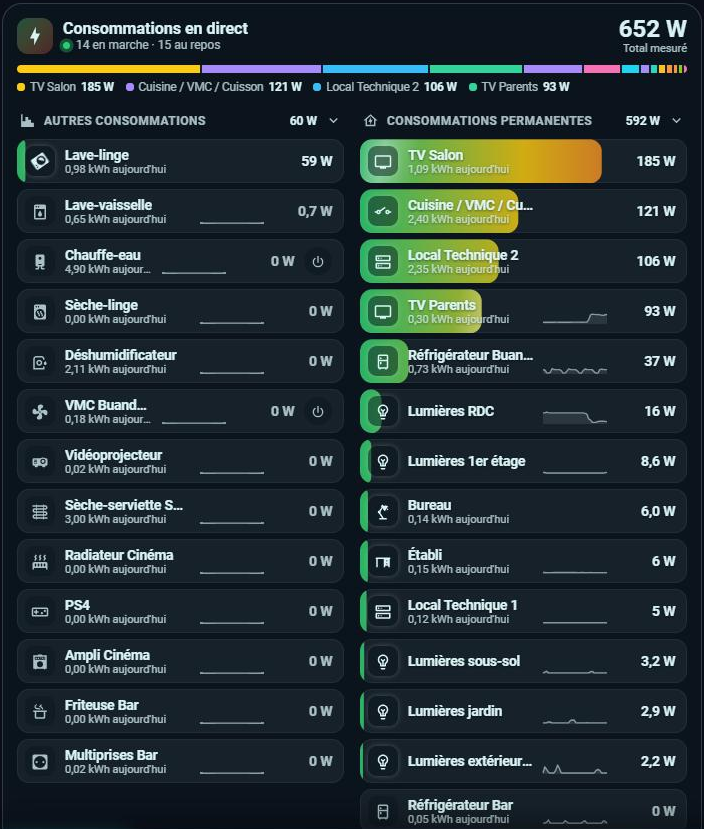
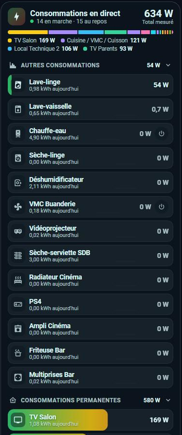
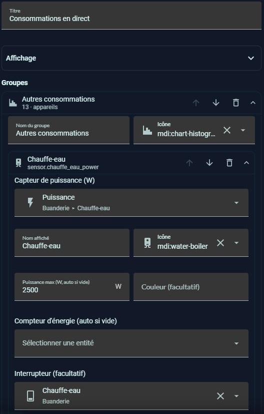
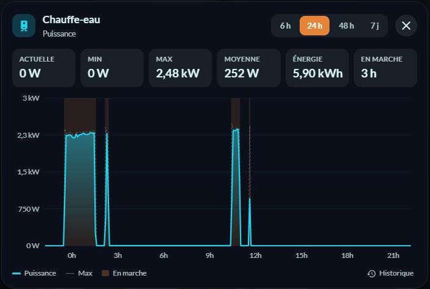
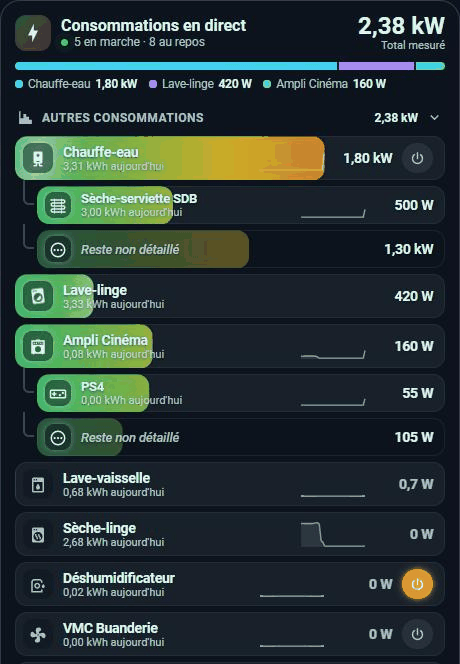

# ⚡ HOLM Live Power Card

[](https://hacs.xyz/)


[🇫🇷 Français](README.md) · 🇬🇧 English

**Each device's live power, sorted into groups, in a modern, animated card — fully configurable in the visual editor.**

No more dozens of copy-pasted `button-card`s: one card shows all your measured devices (smart plugs, clamps, power sensors), sorts them live by what they draw, and shows at a glance what is pulling on the meter.

### At a glance

- 📊 **Header**: smoothly counting total power, number of running and idle devices, a coloured share bar and the four biggest consumers right now.
- 🗂️ **Collapsible groups** (“Other consumption”, “Always-on consumption”…), side by side on wide screens, stacked on mobile, each with its total.
- 🌈 **Rows filled by power**: green → yellow → red gradient against the device's maximum, an animated sheen that speeds up with the load, an icon that lights up (and spins for fans, washing machines, pumps…).
- 🔀 **Live sorting**: a device that starts moves to the top with a smooth slide.
- 📈 **Sparkline** of the last hours and **today's kWh** for each device (energy meter found on its own on the same device).
- 🎯 **Automatic maximum**: with no value set, the scale follows the peak of the last 7 days.
- 📉 **A chart for each device**: tapping a row opens a window with the power curve over 6 h, 24 h, 48 h or 7 days, the running periods, and Current, Min, Max, Average, Energy and Running tiles.
- 🌳 **Sub-devices**: a plug that measures a set and the devices inside it, without double counting, with the part that isn't itemised.
- ⏻ Optional **on / off button** per device, with confirmation before turning off. Off by default: the card stays read-only until you turn it on.
- ✏️ **Complete visual editor**: groups and devices (add, reorder, move between groups), display, colours, and **one-click import of the Energy dashboard devices**.
- 🌍 **8 languages**, light and dark themes, animations off when the system asks for reduced motion.

| The card | On mobile | The editor |
|---|---|---|
|  |  |  |



### 🆕 What's new in 1.2.0

- 🌳 **Sub-devices without double counting** ([#1](https://github.com/kaaribou/holm-live-power-card/issues/1), idea by MilesTEG1): a plug that measures a whole rack, TV unit or sub-panel can have its “sub-devices” measured separately. They are shown indented under it, are no longer counted twice in the total, and a **Rest, not itemised** line shows what isn't measured individually. See [Sub-devices](#sub-devices).
- ⏻ **On / off button** per device, off by default, with confirmation before turning off. See [On / off button](#on--off-button).



---

## Installation

### Through HACS (recommended)

1. HACS → ⋮ menu → **Custom repositories** → add `https://github.com/kaaribou/holm-live-power-card`, category **Dashboard**.
2. Search for **HOLM Live Power Card** and install it.
3. Reload the page (Ctrl + F5).

### Manual

1. Copy `holm-live-power-card.js` to `config/www/community/holm-cards/`.
2. Settings → Dashboards → ⋮ → **Resources** → add `/local/community/holm-cards/holm-live-power-card.js?v=1.2.0`, type **JavaScript module**.
3. Reload the page (Ctrl + F5).

## Configuration

Add the **HOLM – Live power** card from the card picker, then add your devices in the editor (or import the Energy dashboard ones).

```yaml
type: custom:holm-live-power-card
title: Live consumption
groups:
  - name: Other consumption
    icon: mdi:chart-histogram
    devices:
      - entity: sensor.water_heater_power
        name: Water heater
        icon: mdi:water-boiler
        max: 2500
      - entity: sensor.washing_machine_power
        name: Washing machine
        icon: mdi:washing-machine
  - name: Always-on consumption
    icon: mdi:home-lightning-bolt-outline
    devices:
      - entity: sensor.fridge_power
        name: Fridge
```

### Card options

| Option | Description | Default |
|---|---|---|
| `title` | Title | `Live consumption` |
| `language` | Language: `fr`, `en`, `de`, `es`, `it`, `nl`, `pt`, `pl` | the profile's |
| `sort` | `power` (live sorting) or `none` (editor order) | `power` |
| `idle` | Idle devices: `show`, `dim` or `hide` | `show` |
| `idle_threshold` | Threshold in W below which a device is “idle” | `2` |
| `style` | `fill` (filled row) or `bar` (bar under the name) | `fill` |
| `color` | `gradient` (green → red), `level` (colour by level) or `accent` | `gradient` |
| `columns` | Groups side by side: `auto`, `1` or `2` | `auto` |
| `show_total` | Header with total and share | `true` |
| `show_sparkline` | Sparklines | `true` |
| `sparkline_hours` | Sparkline length (h) | `3` |
| `show_energy` | Today's kWh | `true` |
| `total_entity` | Total home consumption (W): shows the measured share and the “not measured” part | — |
| `animation` | Animations | `true` |
| `show_rest` | “Rest, not itemised” row under a device that has sub-devices | `true` |

### Device options

| Option | Description |
|---|---|
| `entity` | Power sensor (W or kW) — **required** |
| `name`, `icon` | Displayed name and icon (otherwise the entity's) |
| `max` | Maximum power for the scale; otherwise the 7-day peak |
| `energy` | Energy meter for today's kWh; otherwise looked up on the same device |
| `color` | Device colour in the share bar |
| `parent` | Sensor of the device that contains this one: it is shown indented and not counted twice (see [Sub-devices](#sub-devices)) |
| `show_switch` | On / off button on the row (see [On / off button](#on--off-button)) |
| `switch` | Switch driven by the button; otherwise the one on the same device |
| `switch_confirm` | `false` to turn off without confirmation (default: confirmation) |

## Sub-devices

When a plug measures a whole set (a server rack, a TV unit, a kitchen power strip…) and some devices of that set also have their own plug, pick **Included in (sub-device of)** for each of them in the editor (`parent` option).

```yaml
devices:
  - entity: sensor.rack_plug_power        # measures the whole rack: 160 W
    name: Server rack
  - entity: sensor.server_1_plug_power    # 40 W
    name: Server 1
    parent: sensor.rack_plug_power
  - entity: sensor.server_2_plug_power    # 15 W
    name: Server 2
    parent: sensor.rack_plug_power
```

| Element | What it is for |
|---|---|
| **Parent device row** | The total power of the set (160 W). This is what counts in the total, the share bar and the top consumers. |
| **Indented rows, linked by a ↳ line** | The sub-devices (40 W, 15 W): their power, sparkline, today's kWh and chart on tap, like the others, but they are **not added a second time** to the total. |
| **“Rest, not itemised” row** (italic) | What the parent uses on top of its sub-devices: 160 − 40 − 15 = 105 W (network, router, UPS…). Hide it with `show_rest: false`. It doesn't open a chart. |

- Live sorting orders the main devices; each keeps its sub-devices (sorted too) and its “Rest” row right below.
- A sub-device always shows under its parent, even if it was added to another group.
- One level only: a sub-device can't have sub-devices itself.

## On / off button

Turn on **On / off button** in a device's settings (`show_switch` option) to switch it on or off from the card.

| Element | What it is for |
|---|---|
| **⏻ button on the right of the row** | Turns the device's switch on or off. **Coloured** (device colour) when on, **grey** when off, **faded** and inactive when the switch is unavailable. |
| **Red “Turn off?”** | To turn off, a first tap asks for confirmation: tap again within 4 seconds. Without a second tap, nothing happens. To turn off with a single tap, untick **Confirm before turning off** (`switch_confirm: false`). Turning on always takes a single tap. |

- **Switch** (`switch`): left empty, the card uses the switch attached to the same device as the power sensor (the case for most smart plugs). You can also pick any `switch`, `light`, `fan` or `input_boolean`.
- Setting a `switch` in YAML is enough to show the button.
- The button is off by default: don't turn it on for a freezer or a server that must never be switched off.

## How it works

- **Live** follows the power sensors' state: rows, total and sorting move as soon as a value changes.
- **Sparklines** and the **automatic maximum** come from Home Assistant's statistics (5-minute means and hourly peaks), **today's kWh** from the energy meter's statistics. Everything is re-read every 5 minutes, without creating any entity.
- **A device's chart** reads its sensor's statistics (5-minute means, minimums and maximums, or hourly over 7 days); for a sensor without statistics it rebuilds the curve from the history. A sensor excluded from the Home Assistant `recorder` has no history: the card says so.
- **Energy dashboard import** adds, in a new group, the Energy dashboard devices that have a power sensor and are not in the card yet.

---

Part of **HOLM — Home Orchestration & Living Management**: smart management and orchestration of the home.

Other projects: [Volets HOLM](https://github.com/kaaribou/volets-holm) · [Climat HOLM](https://github.com/kaaribou/climat-holm) · [Carburant HOLM](https://github.com/kaaribou/carburant-holm) · [Commandes à la maison HOLM](https://github.com/kaaribou/commandes-holm) · [HOLM LaMetric](https://github.com/kaaribou/lametric-holm) · [HOLM My Menu](https://github.com/kaaribou/holm-mymenu) · [HOLM Lektrico](https://github.com/kaaribou/lektrico-holm) · [HOLM GitHub](https://github.com/kaaribou/github-holm) · [HOLM Cars](https://github.com/kaaribou/holm-cars) · [HOLM HP/HC](https://github.com/kaaribou/holm-tarif) · [HOLM Navbar Card](https://github.com/kaaribou/holm-navbar-card) · [HOLM Climate Card](https://github.com/kaaribou/climate-card-holm) · [HOLM Music Card](https://github.com/kaaribou/holm-music-card) · [HOLM Sentinel Card](https://github.com/kaaribou/holm-sentinel-card) · [HOLM Security Card](https://github.com/kaaribou/holm-security-card) · [HOLM Recordings Card](https://github.com/kaaribou/holm-recordings-card) · [HOLM Covers Card](https://github.com/kaaribou/holm-covers-card) · [HOLM Runtime Card](https://github.com/kaaribou/holm-runtime-card) · [HOLM Power Flow Card](https://github.com/kaaribou/holm-power-flow-card) · [HOLM Energy Cards](https://github.com/kaaribou/holm-energy-cards) · [HOLM Radiator Card](https://github.com/kaaribou/holm-radiator-card) · [HOLM Floor Card](https://github.com/kaaribou/holm-floor-card) · [HOLM Ecojoko Card](https://github.com/kaaribou/holm-ecojoko-card) · [HOLM Smoke Card](https://github.com/kaaribou/holm-smoke-card) · [HOLM Family Card](https://github.com/kaaribou/holm-family-card) · [HOLM Solar Optimizer Card](https://github.com/kaaribou/holm-solar-optimizer-card) · [HOLM Govee Light Card](https://github.com/kaaribou/holm-govee-light-card) · [HOLM Leapmotor Card](https://github.com/kaaribou/holm-leapmotor-card). · [HOLM Bins](https://github.com/kaaribou/holm-bins) · [HOLM FX](https://github.com/kaaribou/holm-fx-card) · [HOLM Theme Editor](https://github.com/kaaribou/holm-theme)

MIT licence · [☕ Buy me a beer](https://paypal.me/kaaribou)
