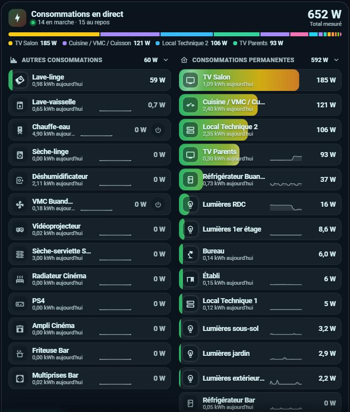
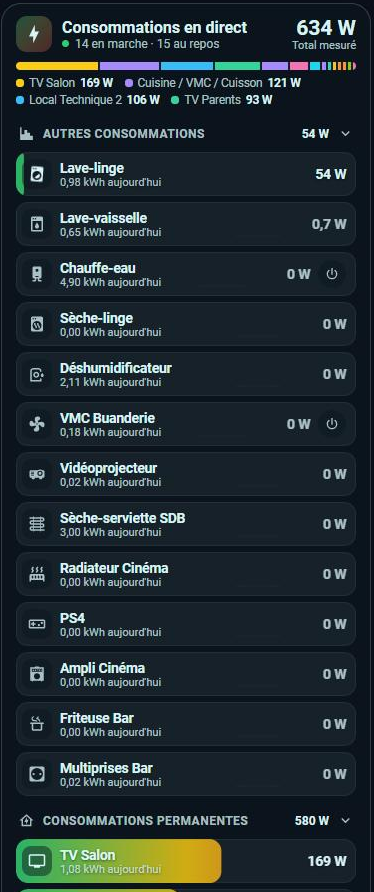
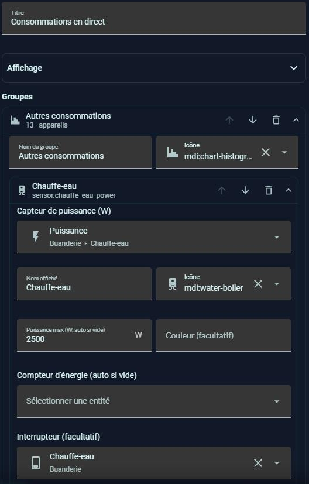
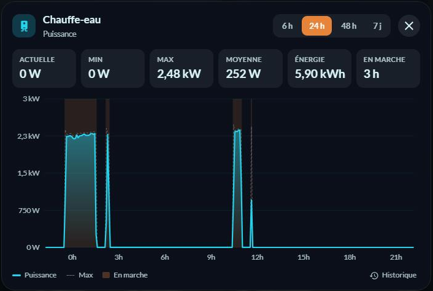

# ⚡ HOLM Live Power Card

[](https://hacs.xyz/)


[🇫🇷 Français](README.md) · 🇬🇧 English

**Each device's live power, sorted into groups, in a modern, animated card — fully configurable in the visual editor.**

No more dozens of copy-pasted `button-card`s: one card shows all your measured devices (smart plugs, clamps, power sensors), sorts them live by what they draw, and shows at a glance what is pulling on the meter.

### At a glance

- 📊 **Header**: smoothly counting total power, number of running and idle devices, a coloured share bar and the four biggest consumers right now.
- 🗂️ **Collapsible groups** (“Other consumption”, “Always-on consumption”…), side by side on wide screens, stacked on mobile, each with its total.
- 🌈 **Rows filled by power**: green → yellow → red gradient against the device's maximum, an animated sheen that speeds up with the load, an icon that lights up (and spins for fans, washing machines, pumps…).
- 🔀 **Live sorting**: a device that starts moves to the top with a smooth slide.
- 📈 **Sparkline** of the last hours and **today's kWh** for each device (energy meter found on its own on the same device).
- 🎯 **Automatic maximum**: with no value set, the scale follows the peak of the last 7 days.
- 📉 **A chart for each device**: tapping a row opens a window with the power curve over 6 h, 24 h, 48 h or 7 days, the running periods, and Current, Min, Max, Average, Energy and Running tiles.
- 🛡️ **Read-only**: the card cannot turn a device on or off, so nothing gets switched off by mistake.
- ✏️ **Complete visual editor**: groups and devices (add, reorder, move between groups), display, colours, and **one-click import of the Energy dashboard devices**.
- 🌍 **8 languages**, light and dark themes, animations off when the system asks for reduced motion.

| The card | On mobile | The editor |
|---|---|---|
|  |  |  |



---

## Installation

### Through HACS (recommended)

1. HACS → ⋮ menu → **Custom repositories** → add `https://github.com/kaaribou/holm-live-power-card`, category **Dashboard**.
2. Search for **HOLM Live Power Card** and install it.
3. Reload the page (Ctrl + F5).

### Manual

1. Copy `holm-live-power-card.js` to `config/www/community/holm-cards/`.
2. Settings → Dashboards → ⋮ → **Resources** → add `/local/community/holm-cards/holm-live-power-card.js?v=1.1.0`, type **JavaScript module**.
3. Reload the page (Ctrl + F5).

## Configuration

Add the **HOLM – Live power** card from the card picker, then add your devices in the editor (or import the Energy dashboard ones).

```yaml
type: custom:holm-live-power-card
title: Live consumption
groups:
  - name: Other consumption
    icon: mdi:chart-histogram
    devices:
      - entity: sensor.water_heater_power
        name: Water heater
        icon: mdi:water-boiler
        max: 2500
      - entity: sensor.washing_machine_power
        name: Washing machine
        icon: mdi:washing-machine
  - name: Always-on consumption
    icon: mdi:home-lightning-bolt-outline
    devices:
      - entity: sensor.fridge_power
        name: Fridge
```

### Card options

| Option | Description | Default |
|---|---|---|
| `title` | Title | `Live consumption` |
| `language` | Language: `fr`, `en`, `de`, `es`, `it`, `nl`, `pt`, `pl` | the profile's |
| `sort` | `power` (live sorting) or `none` (editor order) | `power` |
| `idle` | Idle devices: `show`, `dim` or `hide` | `show` |
| `idle_threshold` | Threshold in W below which a device is “idle” | `2` |
| `style` | `fill` (filled row) or `bar` (bar under the name) | `fill` |
| `color` | `gradient` (green → red), `level` (colour by level) or `accent` | `gradient` |
| `columns` | Groups side by side: `auto`, `1` or `2` | `auto` |
| `show_total` | Header with total and share | `true` |
| `show_sparkline` | Sparklines | `true` |
| `sparkline_hours` | Sparkline length (h) | `3` |
| `show_energy` | Today's kWh | `true` |
| `total_entity` | Total home consumption (W): shows the measured share and the “not measured” part | — |
| `animation` | Animations | `true` |

### Device options

| Option | Description |
|---|---|
| `entity` | Power sensor (W or kW) — **required** |
| `name`, `icon` | Displayed name and icon (otherwise the entity's) |
| `max` | Maximum power for the scale; otherwise the 7-day peak |
| `energy` | Energy meter for today's kWh; otherwise looked up on the same device |
| `color` | Device colour in the share bar |

## How it works

- **Live** follows the power sensors' state: rows, total and sorting move as soon as a value changes.
- **Sparklines** and the **automatic maximum** come from Home Assistant's statistics (5-minute means and hourly peaks), **today's kWh** from the energy meter's statistics. Everything is re-read every 5 minutes, without creating any entity.
- **A device's chart** reads its sensor's statistics (5-minute means, minimums and maximums, or hourly over 7 days); for a sensor without statistics it rebuilds the curve from the history. A sensor excluded from the Home Assistant `recorder` has no history: the card says so.
- **Energy dashboard import** adds, in a new group, the Energy dashboard devices that have a power sensor and are not in the card yet.

---

Part of **HOLM — Home Orchestration & Living Management**: smart management and orchestration of the home.

Other projects: [Volets HOLM](https://github.com/kaaribou/volets-holm) · [Climat HOLM](https://github.com/kaaribou/climat-holm) · [Carburant HOLM](https://github.com/kaaribou/carburant-holm) · [Commandes à la maison HOLM](https://github.com/kaaribou/commandes-holm) · [HOLM LaMetric](https://github.com/kaaribou/lametric-holm) · [HOLM My Menu](https://github.com/kaaribou/holm-mymenu) · [HOLM Lektrico](https://github.com/kaaribou/lektrico-holm) · [HOLM GitHub](https://github.com/kaaribou/github-holm) · [HOLM Solar Optimizer Card](https://github.com/kaaribou/holm-solar-optimizer-card) · [HOLM Navbar Card](https://github.com/kaaribou/holm-navbar-card) · [HOLM Climate Card](https://github.com/kaaribou/climate-card-holm) · [HOLM Music Card](https://github.com/kaaribou/holm-music-card) · [HOLM Sentinel Card](https://github.com/kaaribou/holm-sentinel-card) · [HOLM Security Card](https://github.com/kaaribou/holm-security-card) · [HOLM Recordings Card](https://github.com/kaaribou/holm-recordings-card) · [HOLM Covers Card](https://github.com/kaaribou/holm-covers-card) · [HOLM Runtime Card](https://github.com/kaaribou/holm-runtime-card) · [HOLM Power Flow Card](https://github.com/kaaribou/holm-power-flow-card) · [HOLM Energy Cards](https://github.com/kaaribou/holm-energy-cards) · [HOLM Radiator Card](https://github.com/kaaribou/holm-radiator-card) · [HOLM Floor Card](https://github.com/kaaribou/holm-floor-card) · [HOLM Ecojoko Card](https://github.com/kaaribou/holm-ecojoko-card) · [HOLM Smoke Card](https://github.com/kaaribou/holm-smoke-card) · [HOLM BG Card](https://github.com/kaaribou/holm-bg-card).

MIT licence · [☕ Buy me a beer](https://paypal.me/kaaribou)
