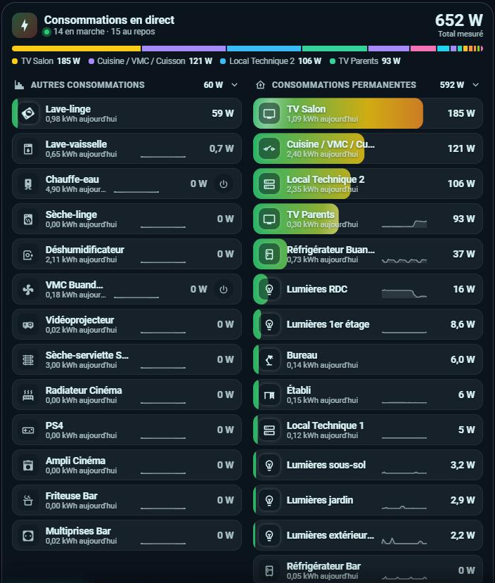
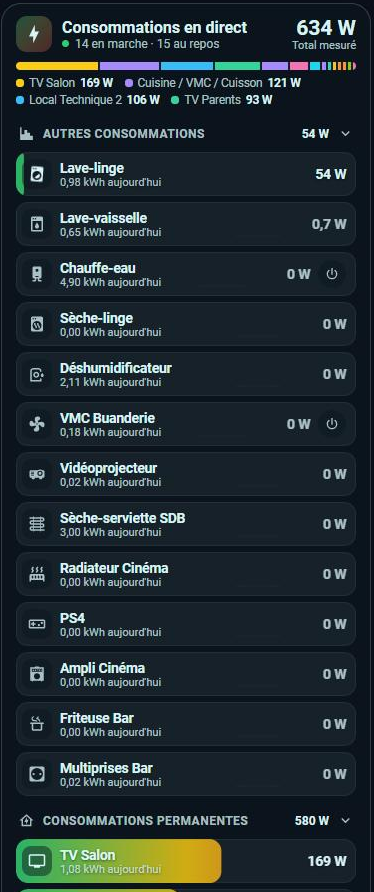
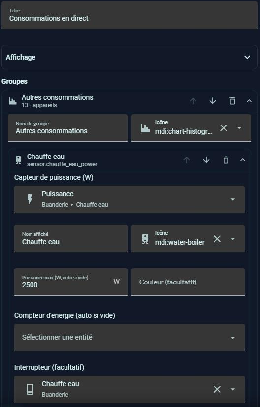
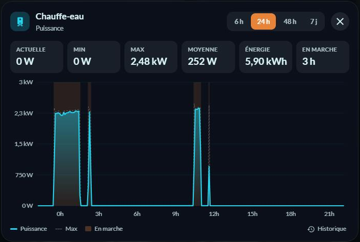

# ⚡ HOLM Live Power Card

[](https://hacs.xyz/)


🇫🇷 Français · [🇬🇧 English](README.en.md)

**La puissance de chaque appareil en direct, rangée par groupes, dans une carte moderne et animée — entièrement réglable dans l'éditeur visuel.**

Fini les dizaines de `button-card` copiées-collées : une seule carte affiche tous vos appareils mesurés (prises connectées, pinces, capteurs de puissance), les trie en direct selon ce qu'ils consomment et montre d'un coup d'œil qui tire sur le compteur.

### En bref

- 📊 **En-tête** : puissance totale qui défile en douceur, nombre d'appareils en marche et au repos, barre de répartition colorée et les quatre plus gros consommateurs du moment.
- 🗂️ **Groupes repliables** (« Autres consommations », « Consommations permanentes »…), côte à côte sur grand écran, empilés sur mobile, avec leur total.
- 🌈 **Lignes remplies selon la puissance** : dégradé vert → jaune → rouge par rapport au maximum de l'appareil, reflet animé qui accélère avec la charge, icône qui s'illumine (et tourne pour les ventilateurs, lave-linge, pompes…).
- 🔀 **Tri en direct** : l'appareil qui démarre remonte en tête avec un glissement animé.
- 📈 **Mini-courbe** des dernières heures et **kWh du jour** pour chaque appareil (compteur d'énergie trouvé tout seul sur le même appareil).
- 🎯 **Maximum automatique** : sans valeur saisie, l'échelle s'adapte au pic des 7 derniers jours.
- 📉 **Un graphique pour chaque appareil** : toucher une ligne ouvre une fenêtre avec la courbe de puissance sur 6 h, 24 h, 48 h ou 7 jours, les périodes de marche, et les tuiles Actuelle, Min, Max, Moyenne, Énergie et En marche.
- 🛡️ **Lecture seule** : la carte ne permet pas d'allumer ou d'éteindre un appareil, impossible de couper un matériel par erreur.
- ✏️ **Éditeur visuel complet** : groupes et appareils (ajouter, réordonner, déplacer d'un groupe à l'autre), affichage, couleurs, et **import des appareils du tableau Énergie** en un clic.
- 🌍 **8 langues**, thème clair et sombre, animations coupées si le système demande moins de mouvement.

| La carte | Sur mobile | L'éditeur |
|---|---|---|
|  |  |  |



---

## Installation

### Via HACS (recommandé)

1. HACS → menu ⋮ → **Dépôts personnalisés** → ajoutez `https://github.com/kaaribou/holm-live-power-card`, catégorie **Tableau de bord**.
2. Recherchez **HOLM Live Power Card** et installez.
3. Rechargez la page (Ctrl + F5).

### Manuelle

1. Copiez `holm-live-power-card.js` dans `config/www/community/holm-cards/`.
2. Paramètres → Tableaux de bord → ⋮ → **Ressources** → ajoutez `/local/community/holm-cards/holm-live-power-card.js?v=1.1.0`, type **Module JavaScript**.
3. Rechargez la page (Ctrl + F5).

## Configuration

Ajoutez la carte **HOLM – Puissance en direct** depuis le sélecteur de cartes, puis ajoutez vos appareils dans l'éditeur (ou importez ceux du tableau Énergie).

```yaml
type: custom:holm-live-power-card
title: Consommations en direct
groups:
  - name: Autres consommations
    icon: mdi:chart-histogram
    devices:
      - entity: sensor.chauffe_eau_power
        name: Chauffe-eau
        icon: mdi:water-boiler
        max: 2500
      - entity: sensor.lave_linge_power
        name: Lave-linge
        icon: mdi:washing-machine
  - name: Consommations permanentes
    icon: mdi:home-lightning-bolt-outline
    devices:
      - entity: sensor.prise_frigo_buanderie_power
        name: Réfrigérateur
```

### Options de la carte

| Option | Description | Par défaut |
|---|---|---|
| `title` | Titre | `Consommations en direct` |
| `language` | Langue : `fr`, `en`, `de`, `es`, `it`, `nl`, `pt`, `pl` | celle du profil |
| `sort` | `power` (tri en direct) ou `none` (ordre de l'éditeur) | `power` |
| `idle` | Appareils au repos : `show`, `dim` (atténués) ou `hide` (masqués) | `show` |
| `idle_threshold` | Seuil en W sous lequel un appareil est « au repos » | `2` |
| `style` | `fill` (ligne remplie) ou `bar` (barre sous le nom) | `fill` |
| `color` | `gradient` (vert → rouge), `level` (couleur selon le niveau) ou `accent` | `gradient` |
| `columns` | Groupes côte à côte : `auto`, `1` ou `2` | `auto` |
| `show_total` | En-tête avec total et répartition | `true` |
| `show_sparkline` | Mini-courbes | `true` |
| `sparkline_hours` | Durée des mini-courbes (h) | `3` |
| `show_energy` | kWh du jour | `true` |
| `total_entity` | Consommation totale de la maison (W) : affiche la part mesurée et le « non mesuré » | — |
| `animation` | Animations | `true` |

### Options d'un appareil

| Option | Description |
|---|---|
| `entity` | Capteur de puissance (W ou kW) — **obligatoire** |
| `name`, `icon` | Nom et icône affichés (sinon ceux de l'entité) |
| `max` | Puissance maximale pour l'échelle ; sinon le pic des 7 derniers jours |
| `energy` | Compteur d'énergie pour les kWh du jour ; sinon cherché sur le même appareil |
| `color` | Couleur de l'appareil dans la barre de répartition |

## Comment ça marche

- **Le direct** suit l'état des capteurs de puissance : les lignes, le total et le tri bougent dès qu'une valeur change.
- **Les mini-courbes** et le **maximum automatique** viennent des statistiques de Home Assistant (moyennes sur 5 minutes et pics horaires), les **kWh du jour** des statistiques du compteur d'énergie. Tout est relu toutes les 5 minutes, sans créer d'entité.
- **Le graphique d'un appareil** lit les statistiques de son capteur (moyennes, minimums et maximums sur 5 minutes, ou par heure sur 7 jours) ; pour un capteur sans statistiques, il recalcule la courbe depuis l'historique. Un capteur exclu de l'enregistreur (`recorder`) de Home Assistant n'a pas d'historique : la carte le signale.
- **L'import du tableau Énergie** ajoute dans un nouveau groupe les appareils du tableau Énergie qui ont un capteur de puissance et ne sont pas déjà dans la carte.

---

Fait partie de **HOLM — Home Orchestration & Living Management** : la gestion et l'orchestration intelligente de la maison.

Les autres projets : [Volets HOLM](https://github.com/kaaribou/volets-holm) · [Climat HOLM](https://github.com/kaaribou/climat-holm) · [Carburant HOLM](https://github.com/kaaribou/carburant-holm) · [Commandes à la maison HOLM](https://github.com/kaaribou/commandes-holm) · [HOLM LaMetric](https://github.com/kaaribou/lametric-holm) · [HOLM My Menu](https://github.com/kaaribou/holm-mymenu) · [HOLM Lektrico](https://github.com/kaaribou/lektrico-holm) · [HOLM GitHub](https://github.com/kaaribou/github-holm) · [HOLM Solar Optimizer Card](https://github.com/kaaribou/holm-solar-optimizer-card) · [HOLM Navbar Card](https://github.com/kaaribou/holm-navbar-card) · [HOLM Climate Card](https://github.com/kaaribou/climate-card-holm) · [HOLM Music Card](https://github.com/kaaribou/holm-music-card) · [HOLM Sentinel Card](https://github.com/kaaribou/holm-sentinel-card) · [HOLM Security Card](https://github.com/kaaribou/holm-security-card) · [HOLM Recordings Card](https://github.com/kaaribou/holm-recordings-card) · [HOLM Covers Card](https://github.com/kaaribou/holm-covers-card) · [HOLM Runtime Card](https://github.com/kaaribou/holm-runtime-card) · [HOLM Power Flow Card](https://github.com/kaaribou/holm-power-flow-card) · [HOLM Energy Cards](https://github.com/kaaribou/holm-energy-cards) · [HOLM Radiator Card](https://github.com/kaaribou/holm-radiator-card) · [HOLM Floor Card](https://github.com/kaaribou/holm-floor-card) · [HOLM Ecojoko Card](https://github.com/kaaribou/holm-ecojoko-card) · [HOLM Smoke Card](https://github.com/kaaribou/holm-smoke-card) · [HOLM BG Card](https://github.com/kaaribou/holm-bg-card).

Licence MIT · [☕ Offrir une bière](https://paypal.me/kaaribou)
